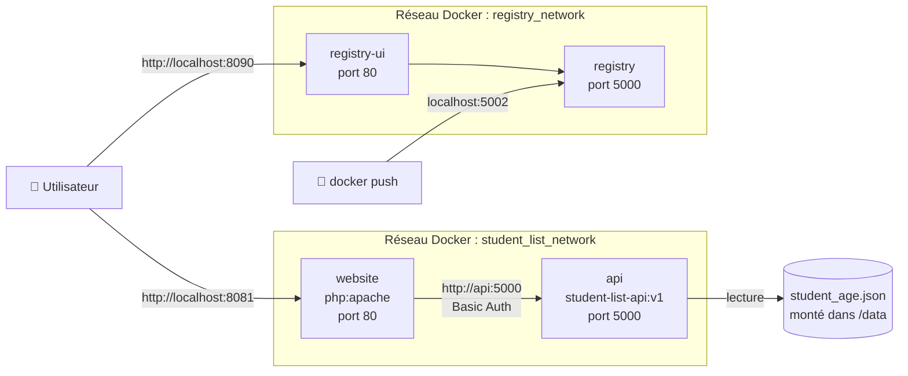
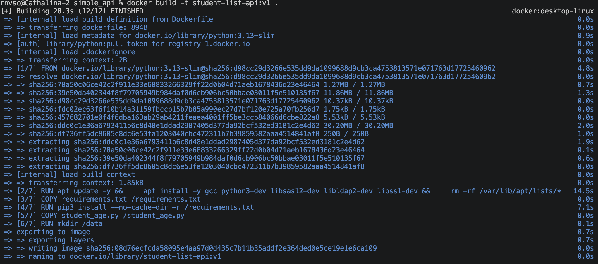
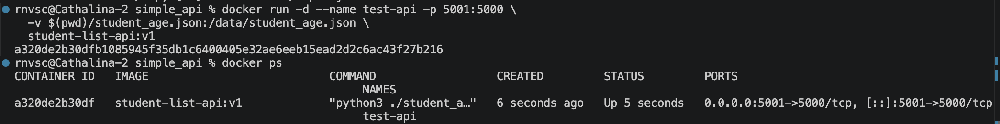
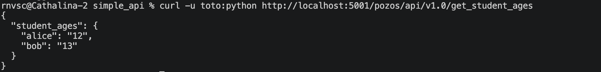
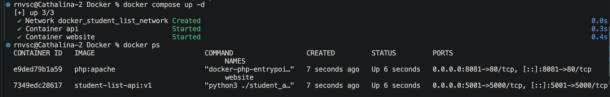
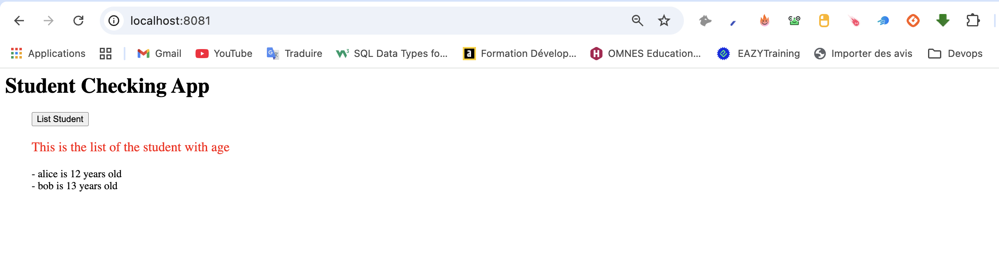
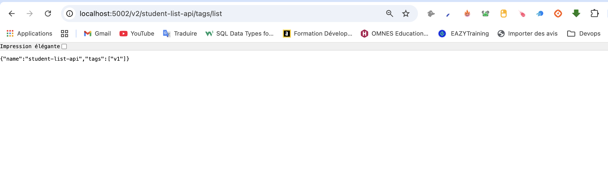
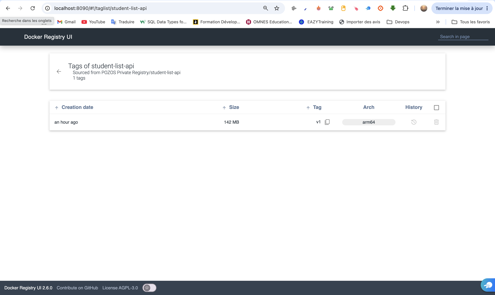

# 🎓 Student List — Conteneurisation d'une application avec Docker


> **En bref :** j'ai transformé une application monolithique, déployée à la main sur un seul serveur, en une infrastructure **découplée, reproductible et versionnée** avec Docker : une image sur mesure pour l'API, un déploiement complet en une commande grâce à Docker Compose, et un **registre d'images privé** auto-hébergé.

**Auteur :** Cathalina — [rnvscathalina22@gmail.com](mailto:rnvscathalina22@gmail.com)

---

## 📌 Sommaire

1. [Le besoin](#-le-besoin)
2. [Architecture](#-architecture)
3. [Compétences démontrées](#-compétences-démontrées)
4. [Structure du dépôt](#-structure-du-dépôt)
5. [Étape 1 — Image Docker de l'API](#-étape-1--image-docker-de-lapi)
6. [Étape 2 — Infrastructure as Code avec Docker Compose](#-étape-2--infrastructure-as-code-avec-docker-compose)
7. [Étape 3 — Registre Docker privé](#-étape-3--registre-docker-privé)
8. [Problèmes rencontrés et solutions](#-problèmes-rencontrés-et-solutions)
9. [Lancer le projet](#-lancer-le-projet)
10. [Pistes d'amélioration](#-pistes-damélioration)

---

## 🎯 Le besoin

**POZOS**, une entreprise qui développe des logiciels pour les lycées, rencontrait trois problèmes :

- l'application tournait sur **un seul serveur**, sans scalabilité ni haute disponibilité ;
- **chaque mise en production posait problème** ;
- l'équipe manquait d'**agilité** pour livrer de nouvelles versions.

**Ma mission :** construire un POC (preuve de concept) montrant comment Docker résout ces problèmes.

L'application, *student_list*, affiche la liste des étudiants avec leur âge. Elle est composée de deux modules :

| Module | Technologie | Rôle |
|---|---|---|
| **API** | Python / Flask | API REST protégée par authentification, qui lit les données dans un fichier JSON |
| **Site web** | PHP / Apache | Interface qui interroge l'API et affiche la liste |


---

## 🏗 Architecture



**Points clés :**
- **Un conteneur par module** : l'API et le site web sont indépendants. On peut mettre à jour, redémarrer ou faire évoluer l'un sans toucher à l'autre.
- **Communication par nom de service** : le site web contacte l'API via `http://api:5000`, grâce au DNS interne de Docker. Aucune adresse IP n'est codée en dur.
- **Réseaux isolés** : l'application et le registre ont chacun leur propre réseau.
- **Données externalisées** : le fichier JSON est monté en volume. On peut modifier les données sans reconstruire l'image.

---

## 💡 Compétences démontrées

| Domaine | Ce que j'ai mis en pratique |
|---|---|
| **Conteneurisation** | Écriture d'un Dockerfile optimisé (ordre des couches, cache, nettoyage) |
| **Infrastructure as Code** | Déploiement complet décrit dans un fichier `docker-compose.yml` versionné |
| **Réseau Docker** | Réseau bridge dédié, résolution DNS entre conteneurs, publication de ports |
| **Persistance** | Volumes et bind mounts pour séparer les données du code |
| **Gestion d'images** | Tag, versionnement (`v1`), push vers un registre privé auto-hébergé |
| **Debugging** | Diagnostic de conflits de ports (`lsof`), lecture des logs, résolution d'erreurs de build |
| **Documentation** | Explication des choix techniques et des écarts par rapport au cahier des charges |

---

## 📂 Structure du dépôt

```
Docker/
├── README.md
├── docker-compose.yml          # Déploiement de l'application (api + website)
├── simple_api/
│   ├── Dockerfile              # Image de l'API
│   ├── requirements.txt        # Dépendances Python
│   ├── student_age.json        # Données (montées dans /data)
│   └── student_age.py          # Code de l'API Flask
├── website/
│   └── index.php               # Interface web (URL de l'API mise à jour)
├── registry/
│   └── docker-compose.yml      # Registre privé + interface web
└── screenshots/                # Captures d'écran du projet
```

---

## 🐳 Étape 1 — Image Docker de l'API

### Le Dockerfile

```dockerfile
FROM python:3.13-slim

LABEL maintainer="Cathalina <rnvscathalina22@gmail.com>"

# Paquets système nécessaires à la compilation de python-ldap (flask-simpleldap)
RUN apt update -y && \
    apt install -y gcc python3-dev libsasl2-dev libldap2-dev libssl-dev && \
    rm -rf /var/lib/apt/lists/*

# Dépendances Python
COPY requirements.txt /requirements.txt
RUN pip3 install --no-cache-dir -r /requirements.txt

# Code source de l'API à la racine
COPY student_age.py /student_age.py

# Dossier des données, déclaré comme volume
RUN mkdir /data
VOLUME /data

EXPOSE 5000

WORKDIR /
CMD [ "python3", "./student_age.py" ]
```

### Mes choix et bonnes pratiques

| Choix | Pourquoi |
|---|---|
| Image `python:3.13-slim` | Image légère, avec moins de paquets inutiles et donc une surface d'attaque réduite |
| Une seule instruction `RUN` pour apt | Moins de couches, et le cache apt est supprimé dans la même couche |
| `rm -rf /var/lib/apt/lists/*` | Image plus légère |
| `requirements.txt` copié **avant** le code | Docker réutilise le cache des dépendances quand seul le code change, ce qui rend les rebuilds bien plus rapides |
| `pip install --no-cache-dir` | Pas de cache pip inutile dans l'image |
| `VOLUME /data` | Les données sont séparées de l'image |

### Build de l'image

```bash
cd simple_api
docker build -t student-list-api:v1 .
```



### Test de l'API seule

```bash
docker run -d --name test-api -p 5001:5000 \
  -v $(pwd)/student_age.json:/data/student_age.json \
  student-list-api:v1

docker logs test-api
```




```bash
curl -u toto:python http://localhost:5001/pozos/api/v1.0/get_student_ages
```

L'API répond avec la liste des étudiants :



---

## ⚙️ Étape 2 — Infrastructure as Code avec Docker Compose

Toute l'application se déploie avec **un seul fichier** et **une seule commande**.

```yaml
services:
  api:
    image: student-list-api:v1
    build: ./simple_api
    container_name: api
    volumes:
      - ./simple_api/student_age.json:/data/student_age.json
    ports:
      - "5001:5000"
    networks:
      - student_list_network
    restart: unless-stopped

  website:
    image: php:apache
    container_name: website
    environment:
      - USERNAME=toto
      - PASSWORD=python
    volumes:
      - ./website:/var/www/html
    depends_on:
      - api
    ports:
      - "8081:80"
    networks:
      - student_list_network
    restart: unless-stopped

networks:
  student_list_network:
    driver: bridge
```

| Élément | Rôle |
|---|---|
| `depends_on: api` | L'API démarre avant le site web |
| `environment` | Les identifiants sont passés au site web par variables d'environnement, sans être écrits dans le code PHP |
| `volumes: ./website:/var/www/html` | Apache sert le site de POZOS au lieu de la page par défaut |
| `networks` | Réseau dédié au projet, isolé des autres conteneurs |
| `restart: unless-stopped` | Les conteneurs redémarrent automatiquement en cas de crash |

### Connexion du site web à l'API

Dans `website/index.php`, l'adresse de l'API utilise le **nom du service Docker** :

```php
$url = 'http://api:5000/pozos/api/v1.0/get_student_ages';
```

Le site web s'adresse au **port interne** de l'API (5000), pas au port publié sur la machine (5001). C'est le DNS de Docker qui résout `api` vers le bon conteneur.

### Déploiement

```bash
docker compose up -d
docker compose ps
```



### Résultat

Sur **http://localhost:8081**, un clic sur **« List Student »** affiche la liste récupérée depuis l'API :



---

## 📦 Étape 3 — Registre Docker privé

### Pourquoi un registre privé ?

Un registre auto-hébergé permet à une entreprise de **garder ses images en interne** : pas de dépendance à un service extérieur comme Docker Hub, contrôle total sur qui peut récupérer quoi, et les images ne quittent pas son infrastructure.

### Déploiement

Deux conteneurs, définis dans `registry/docker-compose.yml` :

| Service | Image | Port | Rôle |
|---|---|---|---|
| `registry` | `registry:2` | 5002 | Stocke les images, avec un volume pour les conserver |
| `registry-ui` | `joxit/docker-registry-ui` | 8090 | Interface web pour parcourir les images |

```bash
cd registry
docker compose up -d
```

### Publication de l'image

```bash
docker tag student-list-api:v1 localhost:5002/student-list-api:v1
docker push localhost:5002/student-list-api:v1
```

Le préfixe `localhost:5002/` indique à Docker d'envoyer l'image vers mon registre plutôt que vers Docker Hub.



### Visualisation

L'image `student-list-api:v1` apparaît dans l'interface sur **http://localhost:8090** :



---

## 🔧 Problèmes rencontrés et solutions

C'est la partie où j'ai le plus appris.

### 1. La commande d'installation fournie faisait échouer le build

**Problème :** la consigne demandait d'installer le paquet `python-dev`. Ce paquet correspond à Python 2 et n'existe plus sur les versions récentes de Debian, utilisées par `python:3.13-slim`.

**Solution :** j'ai retiré `python-dev` et gardé `python3-dev`.

### 2. Une dépendance Python ne s'installait pas

**Problème :** `flask-simpleldap` dépend de `python-ldap`, qui doit être **compilé** en C au moment de l'installation. L'image *slim* ne contient pas de compilateur.

**Solution :** j'ai ajouté `gcc` aux paquets système installés.

### 3. Le port 5000 était déjà occupé sur macOS

**Problème :** au lancement, l'erreur `bind: address already in use` est apparue. Diagnostic avec `lsof -i :5000` : le port était utilisé par **ControlCenter**, c'est-à-dire le Récepteur AirPlay de macOS.

**Solution :** plutôt que de désactiver un service système (la consigne demande de ne pas désactiver de mécanisme de sécurité ou système sans justification), j'ai publié l'API sur le port **5001** de la machine. Le conteneur écoute toujours sur le port **5000**, comme demandé (`EXPOSE 5000`) :

```
-p 5001:5000
   ↑     ↑
 hôte  conteneur
```

### 4. Le port 8080 était déjà pris par Jenkins

**Problème :** un conteneur Jenkins utilisait déjà le port 8080.

**Solution :** le site web est publié sur le port **8081**.

### Récapitulatif des ports

| Service | Port sur la machine | Port dans le conteneur |
|---|---|---|
| API | 5001 | 5000 |
| Site web | 8081 | 80 |
| Registre | 5002 | 5000 |
| Interface du registre | 8090 | 80 |

---

## 🚀 Lancer le projet

**Prérequis :** Docker et Docker Compose.

```bash
git https://github.com/CathalinaRanaivoarison/Docker.git
cd Docker

# Application
docker compose up -d --build
# → http://localhost:8081

# Registre privé
cd registry
docker compose up -d
# → http://localhost:8090
```

**Arrêter :**
```bash
docker compose down            # dans student-list
cd registry && docker compose down
```

> **Environnement de test :** macOS (Apple Silicon) avec Docker Desktop. L'image est donc construite pour l'architecture `arm64`. Sur un serveur Linux classique (`amd64`), il suffit de la reconstruire, ou de produire une image multi-architecture avec `docker buildx`.

---

## 🔮 Pistes d'amélioration

Pour passer de ce POC à un environnement de production :

- **Secrets** : sortir les identifiants dans un fichier `.env` non versionné, ou utiliser Docker Secrets.
- **Serveur de production** : remplacer le serveur de développement Flask par **Gunicorn**.
- **Moins d'exposition** : ne plus publier le port de l'API, puisque le site y accède par le réseau interne.
- **Registre sécurisé** : ajouter HTTPS et une authentification.
- **Healthcheck** : faire attendre au site web que l'API soit réellement prête, pas seulement démarrée.
- **CI/CD** : automatiser le build, les tests et le push de l'image à chaque commit (Jenkins, GitHub Actions).
- **Image multi-architecture** : `docker buildx` pour produire une seule image compatible `arm64` et `amd64`.
- **Utilisateur non-root** : exécuter l'API avec un utilisateur dédié dans le conteneur.

---

## 📬 Contact

**Cathalina** — [rnvscathalina22@gmail.com](mailto:rnvscathalina22@gmail.com)

N'hésitez pas à me contacter pour échanger sur ce projet ou sur une opportunité DevOps.